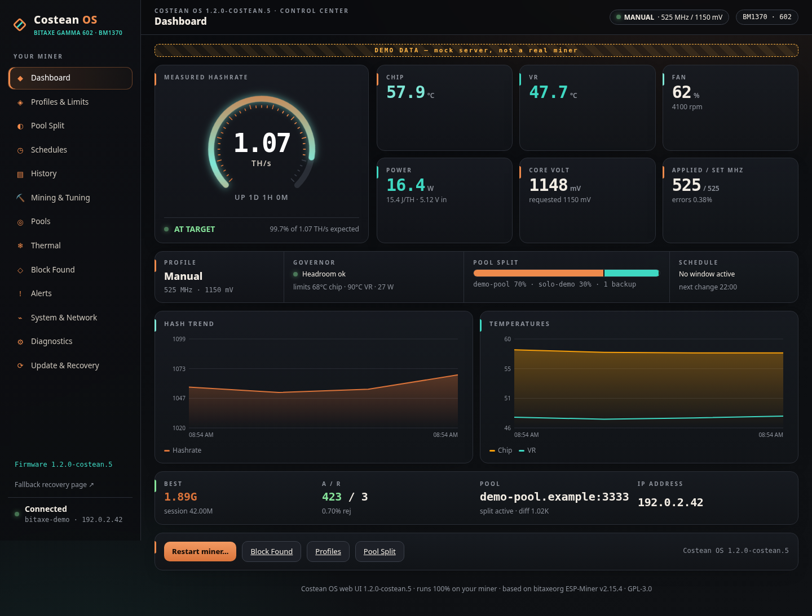
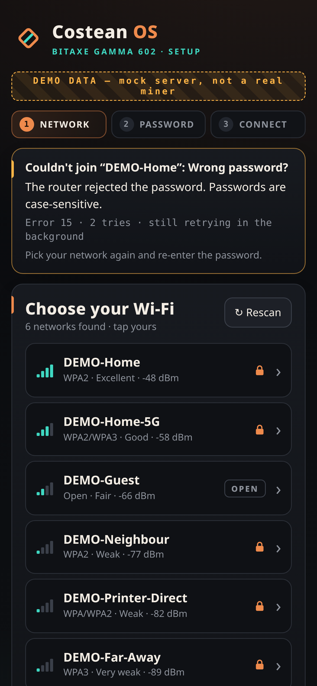
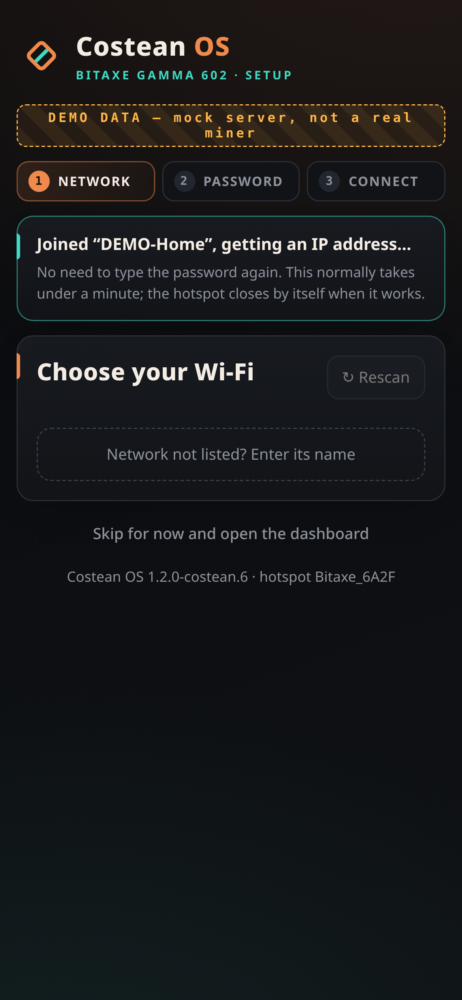
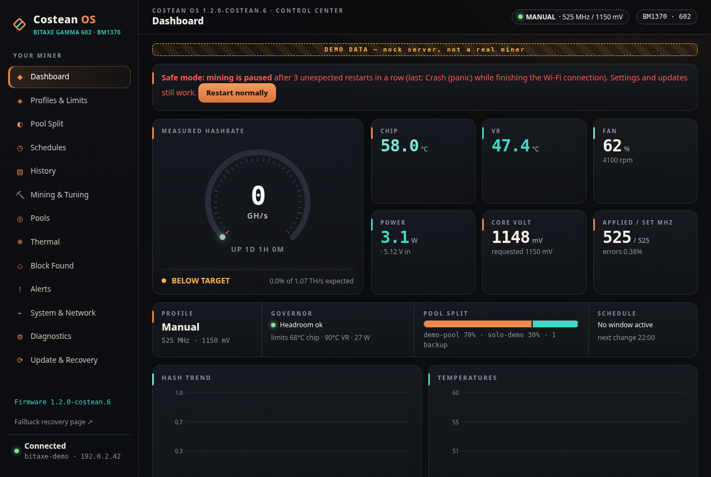
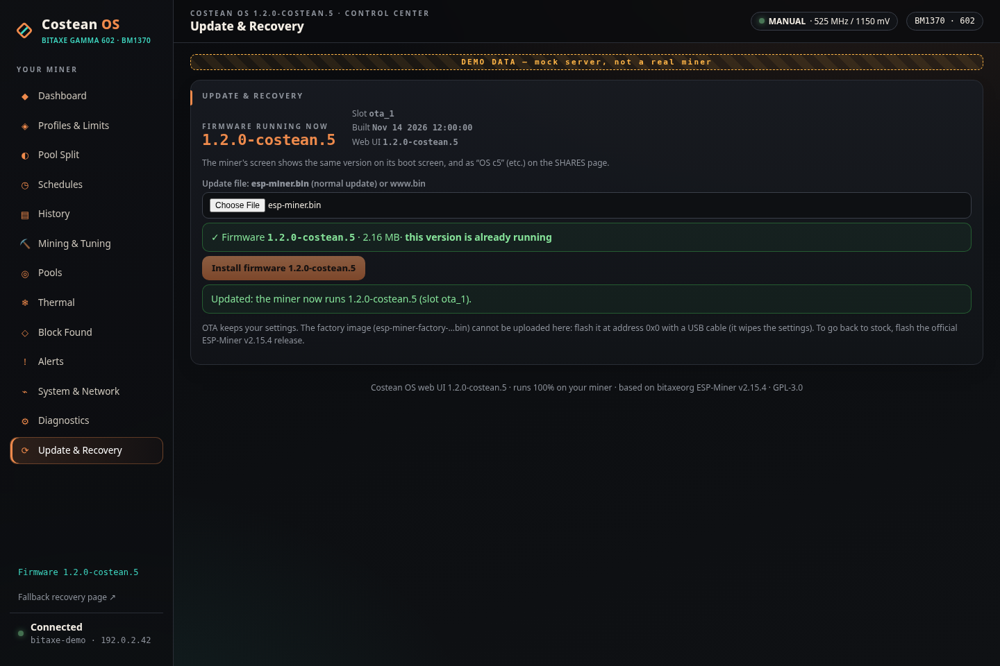
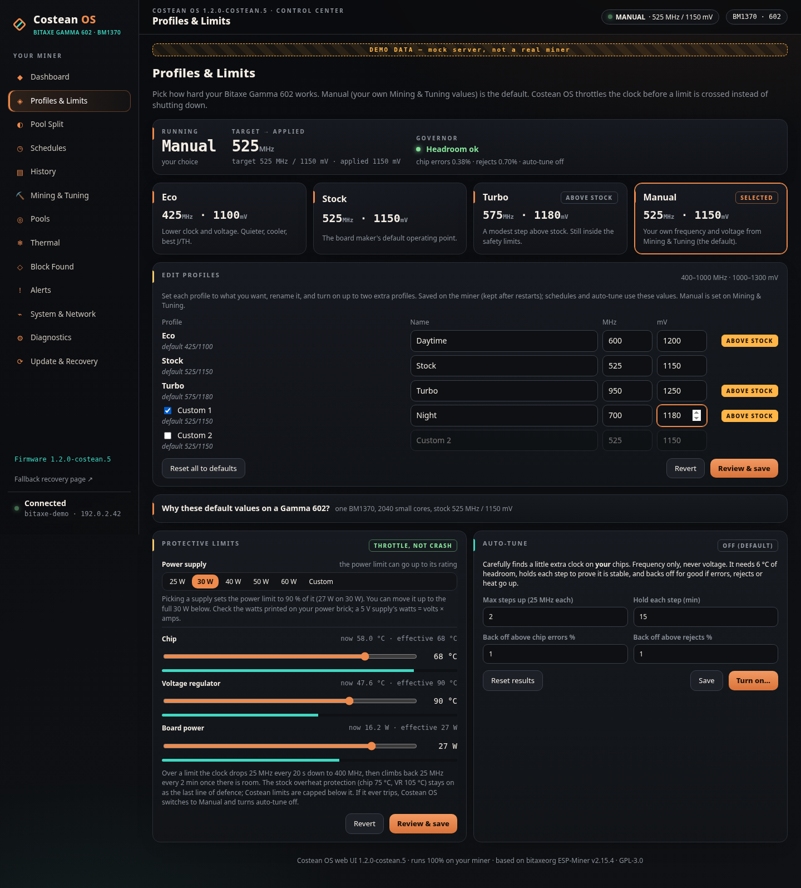
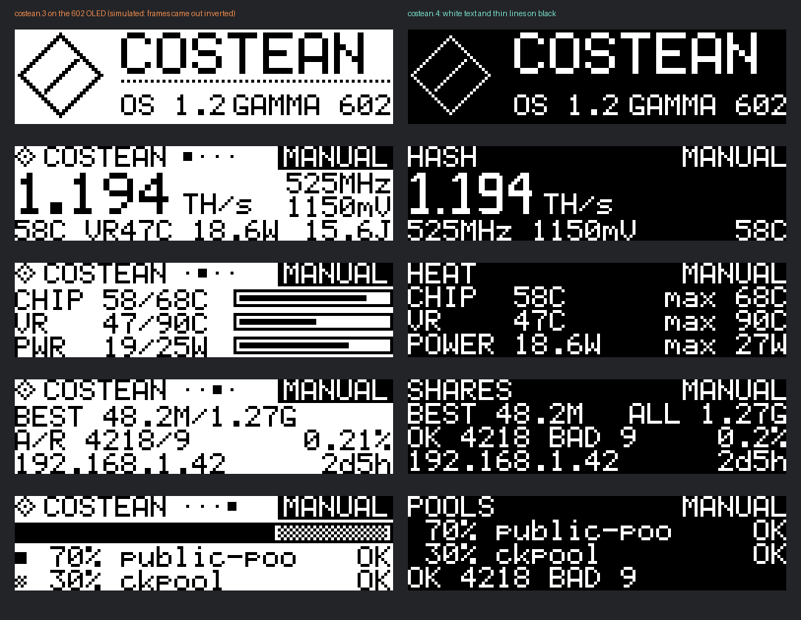
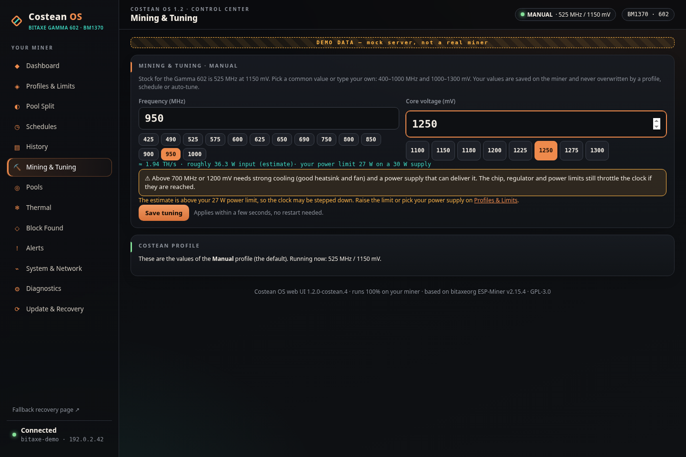
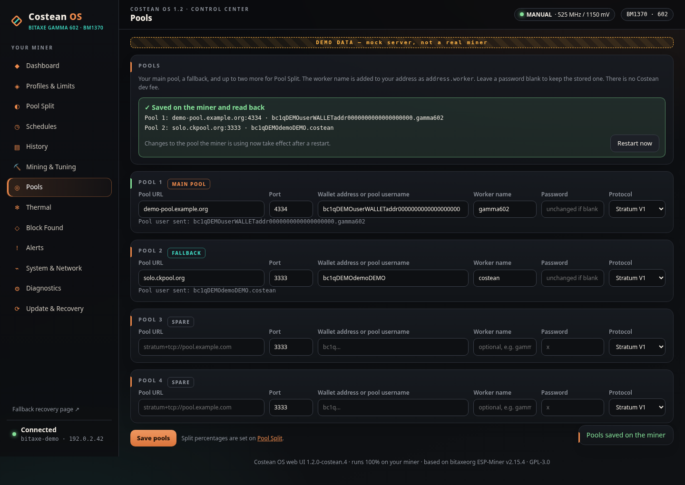
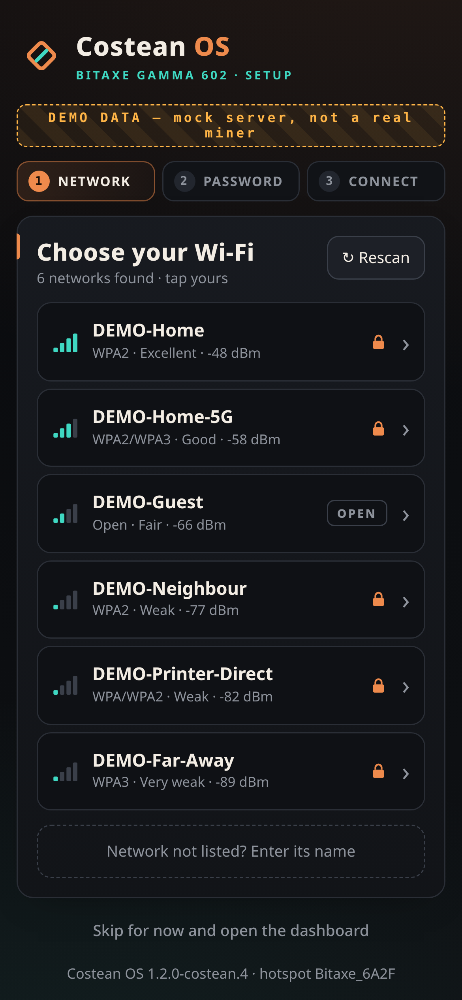

# Costean OS for Bitaxe Gamma 602

> [!WARNING]
> **For the Bitaxe Gamma 602 only (1x BM1370, ESP32-S3, 16 MB flash).** Do not flash it on any other board.
>
> **Not tested on hardware. Flash at your own risk.** The pool split, Discord alerts and schedules were tested only against fake Stratum pools and demo data. Keep the official recovery image handy (see [Recovery](#recover-to-official-esp-miner-v2154)).

Costean OS is a custom firmware for the Bitaxe Gamma 602. (A *costean*, pronounced COS-teen, is an old mining word for a trench dug to find the lode.) It is a source fork of the official [bitaxeorg/ESP-Miner](https://github.com/bitaxeorg/ESP-Miner) **v2.15.4** (GPL-3.0) with a new web UI and extra firmware features written in C.

Version: **1.2.0-costean.7** (Costean OS 1.2, same feature set as Costean OS 1.2 on the NerdOctAxe, scaled for one BM1370), built from **bitaxeorg/ESP-Miner v2.15.4** with **ESP-IDF v6.0.3**.



## New in 1.2.0-costean.7: clean Wi-Fi setup on a fresh miner, crash dump

- **Fixed: a freshly flashed miner thought a network called `myssid` was saved.** The factory settings store an empty Wi-Fi name and password, and the settings loader replaces an empty value with the built-in default, which was the upstream placeholder `myssid` / `mypassword`. So a new miner kept trying to join `myssid`, and the setup page could say *Couldn't join "myssid"*. The defaults are now empty, so a fresh miner simply waits for you to pick a network.
- **Fixed: an open network (no password) could stop working after a restart.** The empty password came back as `mypassword`, so the miner tried WPA2 on an open network. Same fix.
- **Crash dump.** If the firmware ever crashes, it now keeps a crash dump in the existing 64 KB `coredump` flash partition (0xf12000). Nothing changes for normal use; it helps find the cause of a restart without a USB cable attached at the time.
- Includes every costean.6 fix below. costean.6 was not released on its own; costean.7 is the first public build with the Wi-Fi join and restart fixes.

## New in 1.2.0-costean.6: Wi-Fi setup that sticks, restart reasons, safe mode

- **Fixed: after typing the Wi-Fi password the miner could restart again and again, or keep coming back to its `Bitaxe_XXXX` hotspot.** Several problems in the join path, all fixed:
  - **A restart right after "Acquiring IP".** When the IP address arrived, the firmware switched the setup hotspot off *inside* the Wi-Fi event handler, and any error from the Wi-Fi driver there (for example while the setup page was scanning) stopped the firmware and rebooted the miner. The hotspot is now switched off a few seconds later from a separate task, only when no scan is running. It is retried if the driver is busy. A Wi-Fi driver error is logged and never restarts the miner.
  - **Scans during the join.** The setup page scans when it opens. If the phone was still on the hotspot, that scan took the radio off-channel while the miner was getting its IP address (so DHCP timed out), or it cut a join attempt. The miner now refuses to scan while it joins or waits for an IP address, and the page does not ask for one then.
  - **Stuck on the hotspot.** Stock firmware stopped retrying the saved network while any phone was on the hotspot. The miner now keeps retrying: every 3 s at first, then every 10 s, and every 15 s while a phone is on the hotspot. Retries no longer block the Wi-Fi event task.
  - **Bluetooth setup now starts only when it is needed.** If a network is saved, setup Bluetooth starts only after 90 s of failed joins (it used to start 5 s into every join and was torn down on connect). With nothing saved it still starts after 5 s.
  - **Save, then restart.** Settings are now written to flash before every restart the firmware asks for, so the Wi-Fi name and password can no longer be lost by restarting too soon.
  - More stack for the Wi-Fi/IP event task (4096 bytes).
- **Clear reason when the join fails.** The OLED status line and the setup page now say *Wrong password?*, *Network not found* (it uses 2.4 GHz only), *Security type not supported* (WPA3-only, Enterprise or WEP), *Router refused the miner*, *Weak signal* or *No IP address from router*, with the error number and the retry count. The setup page only says "Couldn't join" after a real failure. While the miner is still joining, it says *Joining "…"* or *Joined, getting an IP address…* so you don't type the password again (doing that restarted the miner every time).
- **Restart reasons.** The miner remembers why its last run ended (crash, watchdog, brownout, power-on or a normal restart) and what it was doing then (joining Wi-Fi, waiting for an IP address, powering up the ASIC, starting services, mining). While it is not connected, the OLED status line adds for example `| Last reset: PANIC at DHCP`. The setup page and Diagnostics show the same, plus the Wi-Fi status at the time. Over the API, `/api/system/info` has `lastResetReason`, `lastResetPhase`, `lastResetText`, `lastResetWifi`, `bootCount`, `quickResets`, `safeMode`, `wifiLink`, `wifiFailReason`, `wifiFailCode`, `wifiFailText` and `wifiFailHint`.
- **Boot-loop guard and safe mode.** Three unexpected resets in a row, each within 2 minutes of starting, switch on **safe mode**. Crashes, watchdog resets, brownouts and restarts the firmware did not ask for all count. Power-on, the reset button, USB flashing and normal restarts after saving do not.
  - In safe mode the miner only runs Wi-Fi, the setup hotspot and the web UI. The ASIC stays off, and mining, tuning, pool split, alerts and Bluetooth do not start.
  - The OLED shows `SAFE MODE` with the reason and the miner's address. The web UI shows a red banner with **Restart normally**. Safe mode stays on until you press that button.
- The Setup and Diagnostics pages show the new information. All costean.5, costean.4 and costean.3 fixes are kept.
- **What to look for on the miner's screen:**
  - **`Acquiring IP...`, then a restart:** the post-connect crash fixed above. On costean.6 the status line names the cause on the next boot.
  - **`Wrong password? (Error 15, retry #N)`**, or `Error 204`: the password is wrong, so pick the network again.
  - **`Network not found (Error 201 …)`:** wrong name, out of range, or a 5 GHz-only network.
  - **`SELF-TEST` screen:** see the recovery steps below.





- **Recovering a miner that keeps restarting:** flash `esp-miner-factory-602-v1.2.0-costean.7.bin` at **0x0** over USB (see Flashing). This resets all settings.
  - The first boot after a factory flash runs the built-in **self-test**. If it passes, the miner restarts by itself after about 10 s. If it fails, the screen says so; **hold the BOOT button for 2 seconds** to cancel it.
  - Then join the `Bitaxe_XXXX` hotspot, pick your network and enter the password once.
  - If a miner that is already on costean.6 or later lands in safe mode, open its address and press **Restart normally**.

## New in 1.2.0-costean.5: updates you can check, screen colors, your own profiles

- **Why the costean.4 update did not show up (white OLED background, web page still "costean.3").** Most likely the update never reached the firmware: the upstream web-UI upload (`/api/system/OTAWWW`, used by the "www.bin" box and by the fallback recovery page) took *any* file without checking it, so an `esp-miner.bin` sent there was written into the web-UI area, the page said it worked, the miner restarted, and the old costean.3 firmware kept running (with its inverted OLED pages). The page only ever showed a short pop-up, and nothing checked the version after the restart. Fixed:
  - The miner now **checks every upload before writing anything**. The firmware upload accepts only an ESP32-S3 `esp-miner` app image that fits its slot. The www upload refuses firmware files and factory images. A wrong file gets a clear message (for example *"That is a firmware file (esp-miner.bin). Upload it in the Firmware box, not as www.bin. Nothing was changed."*) and nothing is erased.
  - **New Update & Recovery page:** one file picker that reads the file in your browser and says what it is (*"Firmware 1.2.0-costean.5"*, *"Web UI image: does not change the firmware"*, or *"factory image: flash it at 0x0 over USB"*). After the upload it waits for the restart and reads the version back from the miner. It shows **"Updated: the miner now runs 1.2.0-costean.5 (slot ota_1)"** only when that is true; otherwise it says **"The update did NOT take: the miner still runs …"**. The result stays on the page.
  - Upload errors no longer leave the OLED stuck on the update screen. A failed firmware upload is cancelled cleanly, and interrupted www uploads switch back to the built-in UI.
  - Web pages are no longer cached for 30 days: the browser re-checks them on each load, so you never see an old UI after an update.
  - The recovery page says it is for www.bin only and refuses a firmware file before uploading.
- **How to check which firmware runs:**
  1. In the web UI, the version is in the sidebar ("Firmware 1.2.0-costean.5") and big on Update & Recovery, with the slot (`ota_0` / `ota_1`) and build time.
  2. On the miner, the boot screen now shows the full version (`1.2.0-costean.5`), and the SHARES page shows `OS c5` in turn with the uptime.
  3. Over the API, `/api/system/info` reports `version`, `runningPartition`, `bootPartition` and `firmwareBuilt`.
- **Screen colors: Normal / Inverted** (System & Network → Miner screen). Normal means light text on a black screen and is the default and the recommended setting. Your choice is saved on the miner and applied within a few seconds, with no restart. The code check is unchanged: the costean.4 drawing is correct (the display driver lights what LVGL calls black, like the stock screens and logo), and costean.3 had it backwards.
- **Editable profiles** (Profiles & Limits → Edit profiles):
  - Set **Eco, Stock and Turbo** to any 400–1000 MHz and 1000–1300 mV, and rename them (up to 12 characters).
  - Turn on **Custom 1** and **Custom 2**, two extra profiles with their own names and values.
  - Saved on the miner and kept after restarts. "Default" resets one profile and "Reset all to defaults" resets them all.
  - Applying a profile, schedules and auto-tune all use your values. The miner's screen shows the name in capitals (up to 9 characters).
  - Anything above the stock point (525 MHz / 1150 mV) needs you to type `TURBO`. The protective limits still throttle it.
  - When schedule windows overlap, the first profile in this order wins: Eco, Stock, Manual, Turbo, Custom 1, Custom 2.
  - Manual is still set on Mining & Tuning.
- All fixes from costean.4 and costean.3 are kept.
- **Updating from costean.3 (what the miner runs now):** open Update & Recovery, pick `esp-miner.bin`, and check that it says *Firmware 1.2.0-costean.5*. Click **Install** and wait for *"Updated: the miner now runs 1.2.0-costean.5"*. The costean.3 page you have now has two upload boxes: use the **Firmware (esp-miner.bin)** box, not the www.bin box or the recovery page. If it still shows costean.3 afterwards, flash the factory image at `0x0` over USB.





## New in 1.2.0-costean.4: readable OLED

- **Fixed: Costean OLED pages showed a white background with dark text** on the real 602 screen, which smeared and made the numbers hard to read. Cause: on the small OLED the display driver lights the pixels LVGL calls *black* (that is how the stock screens and logos are drawn), but the Costean pages were written the other way round, so every Costean page came out inverted. New screens also started as an all-white image until their first frame. Both are fixed, and a host test now checks the Costean pages against the stock logo's polarity.
- **Redesigned OLED pages** in the readable style of the stock screens: white text and thin lines on black, nothing filled or inverted. Each page has a plain top line (page name left, profile such as `MANUAL` right) and at most three more lines, or one big number and one small line:
  - **HASH**: big hashrate (new 8×14 digits with 2-pixel strokes and open centres) with TH/s, then `950MHz 1250mV` and the chip temperature.
  - **HEAT**: chip, VR and power against their limits (`max 68C`, or `NEAR 68C` within 3 degrees).
  - **SHARES**: best difficulty (session / all time), accepted / rejected and reject %, IP and uptime.
  - **POOLS**: one line per pool (share %, host, OK / DOWN / SPARE / +FO), or two per line with four pools.
  - **Splash, block found, overheat**: thin diamond outline and plain text, no full-screen white.
  - Throttling and failover swap the profile name for the word THROTTLE / FAILOVER every second (text only).
- Brightness: normal stays at the SSD1306 power-on contrast the stock screens use (0x7F). Scheduled night "dim" is now 0x0F (was 0x06, too faint on some panels). Every frame is drawn from a cleared buffer and sent whole, so no partial-redraw leftovers.
- The small-OLED mining text lines (block, difficulty, scriptsig) are drawn lit as well (they were set to the unlit colour).
- Everything from costean.3 is kept (settings that stick, 400–1000 MHz / 1000–1300 mV tuning, power supply setting).
- **Needs a hardware test**: the polarity is derived from the stock code and logos and checked on the host; please confirm on the 602 that every page is white-on-black.



## New in 1.2.0-costean.3: settings that stick, full tuning range, your power supply

- **Pool, worker and wallet no longer revert.** Root causes fixed: the settings pages refilled their forms from the miner every 2 s (wiping your typing); the Pools page sent empty slots, which made the firmware reject the whole save; and the firmware's settings cache updated a moment late, so the miner reloaded the old pool right after a save. Now forms fill once, only filled pools are sent (merged with the stored record so TLS and other fields are kept), empty slots are accepted by the firmware, the cache updates at once, and the Pools page reads the values back and shows **Saved on the miner and read back**.
- **Separate wallet address and worker fields** (sent as `address.worker`).
- **Manual tuning 400–1000 MHz and 1000–1300 mV**: type a value or tap a preset. Warning above 700 MHz / 1200 mV with a hashrate and power estimate. No 525 / 1150 cap, no `?oc` needed.
- **Power supply setting** on Profiles & Limits: 25 / 30 / 40 / 50 / 60 W or custom (10–150 W). The power limit defaults to 90 % of it (50 W → 45 W) and can go up to the rating. The fixed 35 W cap is gone. Default 30 W supply, 27 W limit.
- Auto-tune ceiling raised to 1000 MHz (still frequency only, at most 4 steps of 25 MHz, **off by default**).
- An out-of-range saved Costean value is corrected on boot instead of throwing away all Costean settings. Costean settings are written to flash within about a second.
- Diagnostics shows the last restart reason and settings-storage health (`nvsWriteErrors`, `nvsUsedEntries`, `nvsFreeEntries` in `/api/system/info`).
- Updating from costean.2 or .1: OTA with `esp-miner.bin` is enough. Save your pool once after the update. If settings still do not stick, or Diagnostics shows write errors, do a clean install with the factory image.





## New in 1.2.0-costean.2: phone Wi-Fi setup

- **Fresh miner, no Wi-Fi saved:** the miner starts its setup hotspot (`Bitaxe_XXXX`, also shown as a QR code on the OLED). Join it from your phone; the sign-in sheet opens the Costean OS setup page by itself (iPhone, Android, Windows captive-portal checks are redirected to the miner).
- The setup page **scans for Wi-Fi straight away** and lists the networks it can hear: name, signal bars, security and a lock icon, strongest first, one row per name. **Rescan** button. Tap your network, type the password (Show/Hide), **Save & connect**. The miner saves it, restarts and joins your Wi-Fi.
- **Hidden network?** "Network not listed? Enter its name" lets you type the name (and tick Open network if it has no password).
- If the saved network can't be joined (for example a wrong password), the hotspot stays up and the setup page says why, so you can pick again. "Skip for now" opens the dashboard.
- Also in System & Network: **Choose Wi-Fi network…** opens the same picker.
- Firmware side: scanning keeps the hotspot running (short per-channel dwell with returns to the hotspot channel), results are cached for 15 s (`GET /api/system/wifi/scan`, add `?refresh=1` for a fresh scan), duplicates and hidden names are dropped, and a busy area with more than 20 networks can no longer overflow the scan buffer. With no Wi-Fi saved the miner no longer keeps trying to join an empty network name, which used to collide with scans. `/api/system/info` adds `apSsid`.



## What is new in 1.2

- **"Lode" look** on the web UI (graphite, copper and teal, diamond logo) and new 128×32 OLED pages: HASH, HEAT, SHARES, POOLS, with the active profile on the top line (THROTTLE when the governor is holding back, FAILOVER when a split pool is down, a clock icon when a schedule set the profile).
- **Profiles: Eco, Stock, Turbo, Manual.** Manual is the default and keeps your saved frequency / voltage, so nothing changes after the update until you pick another profile. Turbo needs you to type `TURBO`.
- **Protective limits that throttle instead of crashing**: chip (default 68 °C), voltage regulator (90 °C) and board power (90 % of the power supply you pick, 27 W on the default 30 W supply). Over a limit the clock steps down 25 MHz every 20 s (never below 400 MHz) and climbs back 25 MHz every 2 min once there is room. Lower clocks are applied before lower voltage. The stock overheat protection is unchanged and stays on underneath; if it ever trips, Costean OS switches to Manual and turns auto-tune off.
- **Auto-tune, off by default**: frequency only (never voltage), at most 1000 MHz and 4 steps (default 2), needs 6 °C headroom, holds each step 15 min, backs off on chip errors above 1 %, rejects above 1 % or heat, and never retries a failed step. Turning it on needs you to type `AUTO-TUNE`.
- **Schedules**: up to 8 weekly windows that switch the profile and/or the OLED (normal, dim, off). Built-in time zone and daylight time rules (default America/New_York). Nothing is applied until the miner has network time (SNTP). Default: the screen dims 22:00–07:00. A scheduled "off" screen still wakes for a block, overheat or identify.
- **History that survives a reboot**: 48 h of 15-minute points (hashrate, power, chip and VR temperature, J/TH, throttle / failover / schedule marks) in flash, saved every 30 min and before a restart.
- **Multi-pool split with failover**: up to 4 weighted pools (percentages that add up to 100) plus any number of 0 % backup pools. Jobs are shared by smooth weighted round robin; a pool that disconnects or has no work drops out at once and its share moves to the healthy pools; it must stay up 30 s before it rejoins. If every weighted pool is down the backups take the work. Per-pool job share, accepted / rejected shares and pool credit (accepted difficulty over 10 min). Changing weights applies live; turning split on or adding a pool needs a restart. V1 only.
- **Kept from 2.15.4-costean.1**: Discord alerts (block found, best difficulty, offline, overheat, periodic status; webhook never returned in full) and the Block Found page.
- New API: `GET /api/costean`, `GET /api/costean/history`, `PATCH /api/costean`. `/api/system/info` adds `poolSplitFailover`, `poolSplitRestartNeeded` and per-pool `healthy`, `backup`, `jobShare`, `creditedGhs`.

### Profiles on the Gamma 602

One BM1370 with 2040 small cores, so expected hashrate is about MHz × 2.04 GH/s. Power figures are estimates; every chip and cooler differs.

| Profile | Frequency / core voltage | Expected | Why |
|---|---|---|---|
| Eco | 425 MHz / 1100 mV | ≈ 0.87 TH/s, ≈ 13–14 W | About 19 % less clock and 50 mV less than stock: cooler, quieter, usually the best J/TH. |
| Stock | 525 MHz / 1150 mV | ≈ 1.07 TH/s, ≈ 16–18 W | Exactly the Bitaxe factory point. |
| Turbo | 575 MHz / 1180 mV | ≈ 1.17 TH/s, ≈ 19–21 W | One modest 50 MHz step and +30 mV, well under the 27 W default power limit and still throttled by the limits. |
| Manual (default) | your Mining & Tuning values | — | Nothing changes after the update. |

These mirror the NerdOctAxe 1.2 profiles in proportion (Eco well under stock, Turbo one step above). Limit ranges: chip 45–73 °C (always 2 °C under the stock 75 °C protection), VR 50–103 °C (under the stock 105 °C), power 10 W up to your power supply rating (10–150 W).

### Unchanged from upstream

- Stock frequency / voltage remains **525 MHz / 1150 mV**; fan control and the stock thermal protection (75 °C chip / 105 °C VR) are unchanged. The Costean Mining & Tuning page allows 400–1000 MHz / 1000–1300 mV without the `?oc` switch.
- Default pool is the official factory default: **public-pool.io:3333**, fallback **solo.ckpool.org:3333**. There is **no Costean dev fee** and no new hardcoded pool addresses.

More screenshots (desktop, mobile and every OLED screen, all demo data) are in [`docs/screenshots/`](docs/screenshots/).

## Downloads

Get the files from the [Releases](../../releases) page.

| File | What it is |
|------|------------|
| `esp-miner-factory-602-v1.2.0-costean.7.bin` | Full factory image (bootloader, partition table, official 602 NVS defaults, firmware, otadata). Flash at **0x0**. **This wipes all settings.** |
| `esp-miner.bin` | OTA app image. Keeps your settings. The Costean web UI is built in. |
| `www.bin` | Optional SPIFFS web UI partition (3 MB), only for the custom-WWW option. Not needed for normal installs. |
| `SHA256SUMS` | SHA-256 of each file. Check it with `sha256sum -c SHA256SUMS`. |

## Flashing

Do not flash a 401/601/other board image onto a 602, or a 602 image onto another board.

### Option A: factory image at 0x0 (clean install, wipes settings)

Hold the BOOT button if the board is not already in download mode. Replace `PORT` with your serial device (for example `/dev/ttyACM0` or `COM3`).

```bash
esptool --chip esp32s3 -p PORT -b 460800 --before default-reset --after hard-reset \
  write-flash --flash-mode dio --flash-size 16MB --flash-freq 80m \
  0x0 esp-miner-factory-602-v1.2.0-costean.7.bin
```

You can also use [esptool-js](https://espressif.github.io/esptool-js/) and flash the factory file at address `0x0`.

After a factory flash the miner starts its setup hotspot (`Bitaxe_XXXX`). Join it with your phone; the setup page opens by itself (if not, open `http://192.168.4.1`). Tap your Wi-Fi, enter the password and save. Then set your pool again. The default pool is the official ESP-Miner default (public-pool.io), so set your own pool right away.

### Option B: OTA update (keeps settings)

Upload `esp-miner.bin` on the miner's update page (AxeOS **Update** page, or Costean **Update & Recovery**), or:

```bash
curl -X POST --data-binary @esp-miner.bin http://YOUR-BITAXE-IP/api/system/OTA
```

Optional custom web UI only:

```bash
curl -X POST --data-binary @www.bin http://YOUR-BITAXE-IP/api/system/OTAWWW
```

After flashing, check that hashrate, temperatures and fan look normal before you turn on the pool split.

## Recover to official ESP-Miner v2.15.4

Costean OS does not re-host the official binaries. Download them from the official release: <https://github.com/bitaxeorg/ESP-Miner/releases/tag/v2.15.4>

- Factory image for 602 (flash at `0x0`, wipes settings): [`esp-miner-factory-602-v2.15.4.bin`](https://github.com/bitaxeorg/ESP-Miner/releases/download/v2.15.4/esp-miner-factory-602-v2.15.4.bin)
  SHA-256 `0be9a5270f36136335a9fe535ffa74c6f8195efdb56d26b53ac65403c90fd86d`
- OTA image (keeps settings): [`esp-miner.bin`](https://github.com/bitaxeorg/ESP-Miner/releases/download/v2.15.4/esp-miner.bin)
  SHA-256 `b28cd642025217a333f569fd66d433e65d5caa02c5be1a31fde960f7f32631bd`

## Building from source

```bash
git clone --recursive <this repo>
cd <this repo>
# ESP-IDF v6.0.3 environment, Node.js 20+ for the web UI
idf.py build
```

The web UI source is in `main/http_server/costean-ui` (Svelte + Vite) and is built and embedded by the normal `idf.py build`.

Tests (no hardware needed):

```bash
test/costean/run.sh                       # governor, scheduler, pool split, 602 profiles, OLED renderer
gcc -Imain -o /tmp/t test/host/test_pool_split_core.c && /tmp/t
python3 test/host/mock_stratum_split.py   # fake Stratum V1 pools
cd main/http_server/costean-ui && npm test && npm run build && node e2e/shots.mjs && node e2e/setup-shots.mjs && node e2e/persist.mjs   # unit, build, screenshots, click-through, save → restart → persist
python3 tools/lode_preview.py /tmp/oled   # render every OLED screen to PNG (1:1, 4x and a contact sheet)
``` The original ESP-Miner README is kept in [`docs/ESP-MINER-UPSTREAM-README.md`](docs/ESP-MINER-UPSTREAM-README.md).

## Known limits

- **Not tested on hardware.** No device was flashed during this build. Everything was tested on the host (unit tests, fake Stratum pools, a mock miner for the web UI).
- One BM1370: split is job sourcing across simultaneous V1 connections, not per-chip assignment. SV2 participants are rejected with an API / UI error.
- Turning split on, or changing which pools take part, needs a restart. Weight changes apply live.
- Schedules need network time; until SNTP syncs, no window is applied.
- High clocks (above about 700 MHz / 1200 mV) are your own risk: the 5 V barrel jack, the power supply and the TPS546 regulator's 25 A warning / 30 A fault current limits were not checked on hardware at 950 MHz / 1250 mV. If the board resets under load, lower the clock or check Diagnostics for the restart reason. The stock overheat protection may also lower the saved frequency if the chip reaches 75 °C.
- `blockFound` is a RAM counter (since last boot), matching upstream.
- Discord webhooks must be `https://discord.com/api/webhooks/…` (or discordapp.com). The URL is never logged or returned in full.
- Going back to 2.15.4-costean.1 or official v2.15.4 by OTA works; the Costean 1.2 settings live in their own NVS namespace (`costean`) and are ignored there. Schedules from 2.15.4-costean.1 are not carried over (the default night-dim schedule is used).

## Credits and license

Costean OS is based on [bitaxeorg/ESP-Miner](https://github.com/bitaxeorg/ESP-Miner) by the Bitaxe / OSMU contributors. All upstream history is kept in this repository. ESP-Miner is licensed under the GNU General Public License v3.0, and so is Costean OS; see [LICENSE](LICENSE). The Costean web UI is GPL-3.0-or-later.

This is an unofficial fork and is not affiliated with or endorsed by the Bitaxe project.
