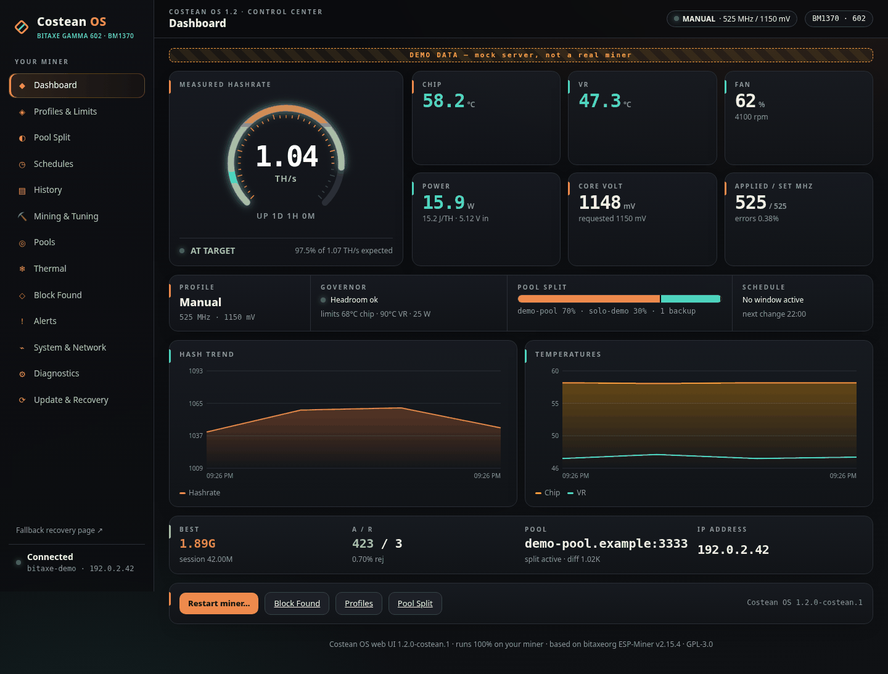

# Costean OS for Bitaxe Gamma 602

> [!WARNING]
> **For the Bitaxe Gamma 602 only (1x BM1370, ESP32-S3, 16 MB flash).** Do not flash it on any other board.
>
> **Not tested on hardware. Flash at your own risk.** The pool split, Discord alerts and schedules were tested only against fake Stratum pools and demo data. Keep the official recovery image handy (see [Recovery](#recover-to-official-esp-miner-v2154)).

Costean OS is a custom firmware for the Bitaxe Gamma 602. (A *costean*, pronounced COS-teen, is an old mining word for a trench dug to find the lode.) It is a source fork of the official [bitaxeorg/ESP-Miner](https://github.com/bitaxeorg/ESP-Miner) **v2.15.4** (GPL-3.0) with a new web UI and extra firmware features written in C.

Version: **1.2.0-costean.1** (Costean OS 1.2, same feature set as Costean OS 1.2 on the NerdOctAxe, scaled for one BM1370), built from **bitaxeorg/ESP-Miner v2.15.4** with **ESP-IDF v6.0.3**.



## What is new in 1.2

- **"Lode" look** on the web UI and the 128×32 OLED: graphite, copper and teal, diamond logo. OLED pages: HASH, HEAT, SHARES, POOLS, with the active profile in the header (blinks THROTTLE when the governor is holding back, FAILOVER when a split pool is down, a clock icon when a schedule set the profile).
- **Profiles: Eco, Stock, Turbo, Manual.** Manual is the default and keeps your saved frequency / voltage, so nothing changes after the update until you pick another profile. Turbo needs you to type `TURBO`.
- **Protective limits that throttle instead of crashing**: chip (default 68 °C), voltage regulator (90 °C) and board power (25 W). Over a limit the clock steps down 25 MHz every 20 s (never below 400 MHz) and climbs back 25 MHz every 2 min once there is room. Lower clocks are applied before lower voltage. The stock overheat protection is unchanged and stays on underneath; if it ever trips, Costean OS switches to Manual and turns auto-tune off.
- **Auto-tune, off by default**: frequency only (never voltage), at most 690 MHz, needs 6 °C headroom, holds each step 15 min, backs off on chip errors above 1 %, rejects above 1 % or heat, and never retries a failed step. Turning it on needs you to type `AUTO-TUNE`.
- **Schedules**: up to 8 weekly windows that switch the profile and/or the OLED (normal, dim, off). Built-in time zone and daylight time rules (default America/New_York). Nothing is applied until the miner has network time (SNTP). Default: the screen dims 22:00–07:00. A scheduled "off" screen still wakes for a block, overheat or identify.
- **History that survives a reboot**: 48 h of 15-minute points (hashrate, power, chip and VR temperature, J/TH, throttle / failover / schedule marks) in flash, saved every 30 min and before a restart.
- **Multi-pool split with failover**: up to 4 weighted pools (percentages that add up to 100) plus any number of 0 % backup pools. Jobs are shared by smooth weighted round robin; a pool that disconnects or has no work drops out at once and its share moves to the healthy pools; it must stay up 30 s before it rejoins. If every weighted pool is down the backups take the work. Per-pool job share, accepted / rejected shares and pool credit (accepted difficulty over 10 min). Changing weights applies live; turning split on or adding a pool needs a restart. V1 only.
- **Kept from 2.15.4-costean.1**: Discord alerts (block found, best difficulty, offline, overheat, periodic status; webhook never returned in full) and the Block Found page.
- New API: `GET /api/costean`, `GET /api/costean/history`, `PATCH /api/costean`. `/api/system/info` adds `poolSplitFailover`, `poolSplitRestartNeeded` and per-pool `healthy`, `backup`, `jobShare`, `creditedGhs`.

### Profiles on the Gamma 602

One BM1370 with 2040 small cores, so expected hashrate is about MHz × 2.04 GH/s. Power figures are estimates; every chip and cooler differs.

| Profile | Frequency / core voltage | Expected | Why |
|---|---|---|---|
| Eco | 425 MHz / 1100 mV | ≈ 0.87 TH/s, ≈ 13–14 W | About 19 % less clock and 50 mV less than stock: cooler, quieter, usually the best J/TH. |
| Stock | 525 MHz / 1150 mV | ≈ 1.07 TH/s, ≈ 16–18 W | Exactly the Bitaxe factory point. |
| Turbo | 575 MHz / 1180 mV | ≈ 1.17 TH/s, ≈ 19–21 W | One modest 50 MHz step and +30 mV, well under the 25 W default power limit and still throttled by the limits. |
| Manual (default) | your Mining & Tuning values | — | Nothing changes after the update. |

These mirror the NerdOctAxe 1.2 profiles in proportion (Eco well under stock, Turbo one step above). Limit ranges: chip 45–73 °C (always 2 °C under the stock 75 °C protection), VR 50–103 °C (under the stock 105 °C), power 10–35 W.

### Unchanged from upstream

- Stock frequency / voltage remains **525 MHz / 1150 mV**; official presets, `?oc` overclock gating, fan control and the stock thermal protection are unchanged.
- Default pool is the official factory default: **public-pool.io:3333**, fallback **solo.ckpool.org:3333**. There is **no Costean dev fee** and no new hardcoded pool addresses.

More screenshots (desktop, mobile and every OLED screen, all demo data) are in [`docs/screenshots/`](docs/screenshots/).

## Downloads

Get the files from the [Releases](../../releases) page.

| File | What it is |
|------|------------|
| `esp-miner-factory-602-v1.2.0-costean.1.bin` | Full factory image (bootloader, partition table, official 602 NVS defaults, firmware, otadata). Flash at **0x0**. **This wipes all settings.** |
| `esp-miner.bin` | OTA app image. Keeps your settings. The Costean web UI is built in. |
| `www.bin` | Optional SPIFFS web UI partition (3 MB), only for the custom-WWW option. Not needed for normal installs. |
| `SHA256SUMS` | SHA-256 of each file. Check it with `sha256sum -c SHA256SUMS`. |

## Flashing

Do not flash a 401/601/other board image onto a 602, or a 602 image onto another board.

### Option A: factory image at 0x0 (clean install, wipes settings)

Hold the BOOT button if the board is not already in download mode. Replace `PORT` with your serial device (for example `/dev/ttyACM0` or `COM3`).

```bash
esptool --chip esp32s3 -p PORT -b 460800 --before default-reset --after hard-reset \
  write-flash --flash-mode dio --flash-size 16MB --flash-freq 80m \
  0x0 esp-miner-factory-602-v1.2.0-costean.1.bin
```

You can also use [esptool-js](https://espressif.github.io/esptool-js/) and flash the factory file at address `0x0`.

After a factory flash the miner starts its setup hotspot. Connect to it, open `http://192.168.4.1`, and set your Wi-Fi and pool again. The default pool is the official ESP-Miner default (public-pool.io), so set your own pool right away.

### Option B: OTA update (keeps settings)

Upload `esp-miner.bin` on the miner's update page (AxeOS **Update** page, or Costean **Update & Recovery**), or:

```bash
curl -X POST --data-binary @esp-miner.bin http://YOUR-BITAXE-IP/api/system/OTA
```

Optional custom web UI only:

```bash
curl -X POST --data-binary @www.bin http://YOUR-BITAXE-IP/api/system/OTAWWW
```

After flashing, check that hashrate, temperatures and fan look normal before you turn on the pool split.

## Recover to official ESP-Miner v2.15.4

Costean OS does not re-host the official binaries. Download them from the official release: <https://github.com/bitaxeorg/ESP-Miner/releases/tag/v2.15.4>

- Factory image for 602 (flash at `0x0`, wipes settings): [`esp-miner-factory-602-v2.15.4.bin`](https://github.com/bitaxeorg/ESP-Miner/releases/download/v2.15.4/esp-miner-factory-602-v2.15.4.bin)
  SHA-256 `0be9a5270f36136335a9fe535ffa74c6f8195efdb56d26b53ac65403c90fd86d`
- OTA image (keeps settings): [`esp-miner.bin`](https://github.com/bitaxeorg/ESP-Miner/releases/download/v2.15.4/esp-miner.bin)
  SHA-256 `b28cd642025217a333f569fd66d433e65d5caa02c5be1a31fde960f7f32631bd`

## Building from source

```bash
git clone --recursive <this repo>
cd <this repo>
# ESP-IDF v6.0.3 environment, Node.js 20+ for the web UI
idf.py build
```

The web UI source is in `main/http_server/costean-ui` (Svelte + Vite) and is built and embedded by the normal `idf.py build`.

Tests (no hardware needed):

```bash
test/costean/run.sh                       # governor, scheduler, pool split, 602 profiles, OLED renderer
gcc -Imain -o /tmp/t test/host/test_pool_split_core.c && /tmp/t
python3 test/host/mock_stratum_split.py   # fake Stratum V1 pools
cd main/http_server/costean-ui && npm test && npm run build && node e2e/shots.mjs   # unit, build, screenshots + demo click-through
python3 tools/lode_preview.py /tmp/oled   # render every OLED screen to PNG
``` The original ESP-Miner README is kept in [`docs/ESP-MINER-UPSTREAM-README.md`](docs/ESP-MINER-UPSTREAM-README.md).

## Known limits

- **Not tested on hardware.** No device was flashed during this build. Everything was tested on the host (unit tests, fake Stratum pools, a mock miner for the web UI).
- One BM1370: split is job sourcing across simultaneous V1 connections, not per-chip assignment. SV2 participants are rejected with an API / UI error.
- Turning split on, or changing which pools take part, needs a restart. Weight changes apply live.
- Schedules need network time; until SNTP syncs, no window is applied.
- `blockFound` is a RAM counter (since last boot), matching upstream.
- Discord webhooks must be `https://discord.com/api/webhooks/…` (or discordapp.com). The URL is never logged or returned in full.
- Going back to 2.15.4-costean.1 or official v2.15.4 by OTA works; the Costean 1.2 settings live in their own NVS namespace (`costean`) and are ignored there. Schedules from 2.15.4-costean.1 are not carried over (the default night-dim schedule is used).

## Credits and license

Costean OS is based on [bitaxeorg/ESP-Miner](https://github.com/bitaxeorg/ESP-Miner) by the Bitaxe / OSMU contributors. All upstream history is kept in this repository. ESP-Miner is licensed under the GNU General Public License v3.0, and so is Costean OS; see [LICENSE](LICENSE). The Costean web UI is GPL-3.0-or-later.

This is an unofficial fork and is not affiliated with or endorsed by the Bitaxe project.
